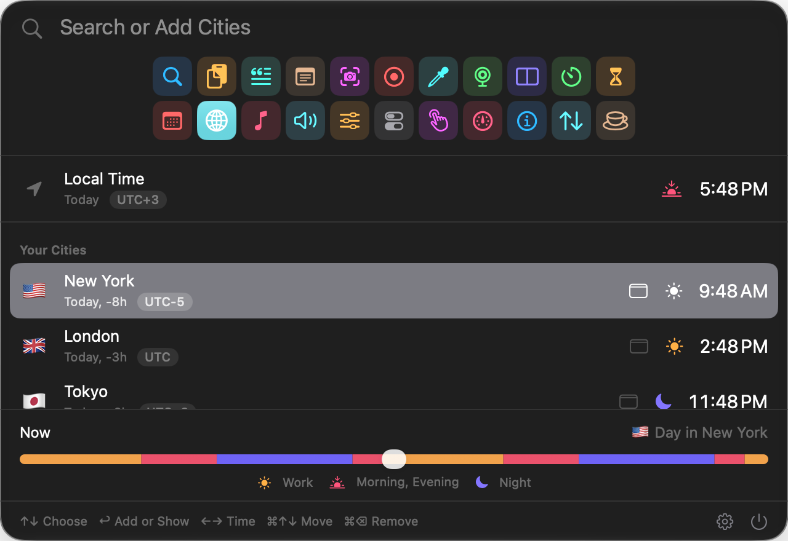
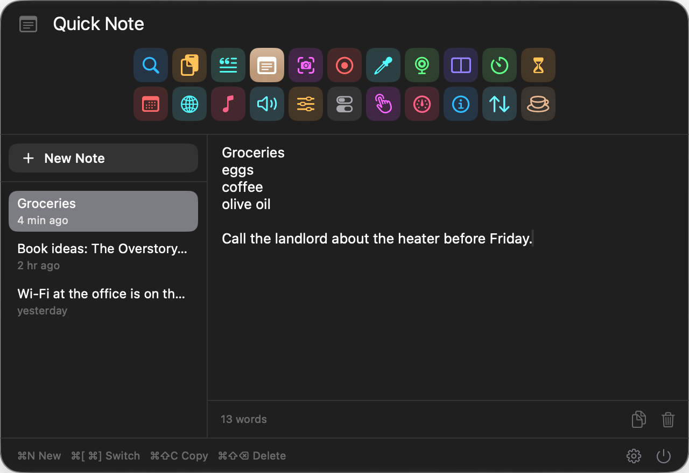
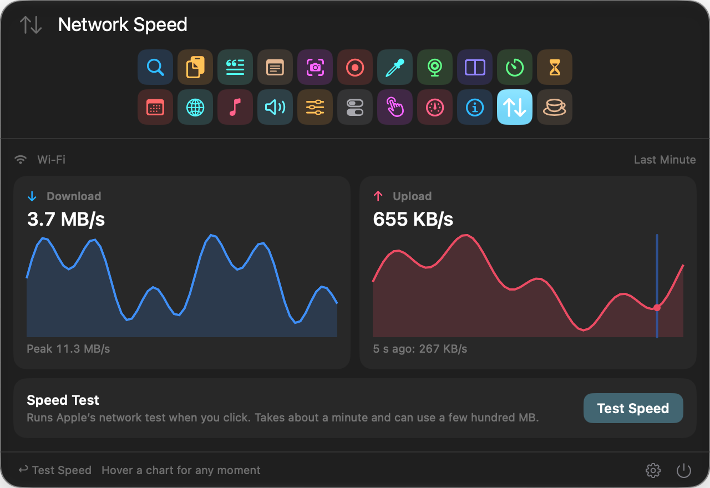
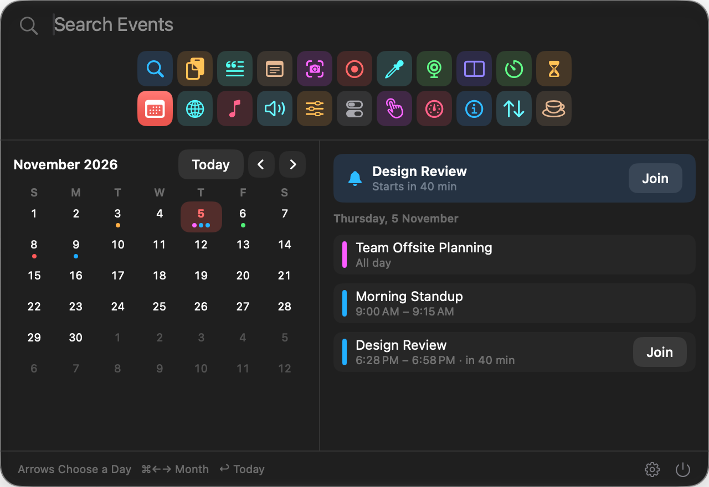

# Toolbelt

A native macOS menu bar app with 22 small tools in one place: app launcher, clipboard history, screenshots, notes, timers, world clock, network speed and more. Each one is a click or a shortcut away.

Everything is stored locally on your Mac, with no account and no server.



## Requirements

- macOS 26 or later
- Xcode 26 or later, only if you build it yourself (developed with Xcode 27.2)
- An Apple silicon Mac (M1 or later). Intel Macs aren't supported.

### Which Mac runs which tool

Most tools work on any supported Mac. These depend on the hardware:

| | MacBook Pro | MacBook Air | iMac | Mac mini, Studio, Pro |
|---|---|---|---|---|
| **Knock** | M2 or later, M1 Pro, M1 Max | M2 or later | No | No |
| **Camera** | Yes | Yes | Yes | With a connected camera or iPhone |
| **Battery in System and Info** | Yes | Yes | No | No |
| **Fans in System** | Yes | No | Yes | Yes |

In the app, **Settings > Compatibility** checks your Mac and shows what each tool needs. Some tools also need a permission, listed under [Permissions](#permissions).

## Install

### Download

1. Download [Toolbelt.dmg](https://github.com/GutemaG/Toolbelt/releases/latest/download/Toolbelt.dmg) and open it.
2. In the window that appears, drag Toolbelt onto Applications.
3. Open Toolbelt from your Applications folder. macOS blocks it because it isn't notarized by Apple, so click **Done**.
4. Go to **System Settings > Privacy & Security**, scroll down to Security, and click **Open Anyway**.
5. Look for the new icon in your menu bar. Toolbelt has no Dock icon.

Releases are signed with the same certificate, so your permissions carry over when you update.

### Build from source

This takes about 30 seconds.

1. Install [Xcode](https://apps.apple.com/app/xcode/id497799835) and open it once to finish setup.
2. Clone the repo and run the build script:

   ```bash
   git clone https://github.com/GutemaG/Toolbelt.git
   cd Toolbelt
   ./build.sh --open
   ```

3. Look for the new icon in your menu bar. Toolbelt has no Dock icon.

The script installs the app to `~/Applications/Toolbelt.app` and opens it. To start it automatically, turn on the open at login option in Settings.

### Update

From version 0.3, Toolbelt checks for updates once a day and installs them with one click. You can also use **Check for Updates…** in its menu or Settings, or turn automatic checks off in Settings. Versions 0.1 and 0.2 can't update themselves, so download the latest version once.

If you built it yourself:

```bash
git pull
./build.sh --open
```

When you build it yourself without a certificate, the build is signed only for your own Mac, and macOS may ask you to allow its permissions again after a rebuild.

### Uninstall

Quit Toolbelt, then delete the app. To remove your notes, clipboard history and settings too:

```bash
rm -rf ~/Applications/Toolbelt.app
rm -rf ~/Library/Application\ Support/Toolbelt
defaults delete com.birhanu.toolbelt
```

## Tools

| | Tool | What it does |
|---|---|---|
| **Everyday** | Launcher | Find and open apps, with your pinned apps on top |
| | Clipboard | Search everything you copied and paste it again |
| | Snippets | Saved text you paste by keyword or search |
| | Quick Note | Jot something down, saved as you type |
| | Windows | Snap the front window to halves, thirds or full size |
| **Capture** | Screenshots | Capture an area, a window or the whole screen |
| | Recording | Record an area, a window or the screen to a movie |
| | Colors | Pick any color on the screen and copy it |
| | Camera | A live camera preview, like a mirror |
| **Time** | Timer | Count down, with the time left in the menu bar |
| | Pomodoro | Focus and take breaks in turn |
| | Calendar | The month and your events, with a join button for calls |
| | World Clock | See the time in other cities, with one in the menu bar |
| **Sound** | Now Playing | See and control the song in Music or Spotify |
| | Sound | Switch between speakers, headphones and AirPods |
| | Volume Mixer | Turn each app up, down or off on its own |
| **Your Mac** | Toggles | Dark Mode, desktop icons, hidden files, lock and more |
| | Knock | Knock on your MacBook to play music, take a screenshot and more |
| | System | CPU, memory, temperature, fans, and the apps using the most energy |
| | Info | Battery health, storage, hardware, network and developer tools |
| | Network Speed | Live upload and download speed, and a speed test |
| | Keep Awake | Stop the Mac from sleeping for a while |

Knock needs an Apple silicon MacBook with a motion sensor (M2 or later, M1 Pro or M1 Max). It reads the sensor through an undocumented interface, so a future macOS update could break it.

## Screenshots

| Quick Note | Network Speed |
|---|---|
|  |  |

| Calendar | World Clock |
|---|---|
|  |  |

These use sample data.

## Default shortcuts

You can change or clear these in each tool's Settings page.

| Action | Shortcut |
|---|---|
| Open Launcher | ⌥Space |
| Open Clipboard | ⌘⇧V |
| Open Snippets | ⌃⌥S |
| Open Quick Note | ⌃⌥N |
| Copy text from the screen | ⌃⇧2 |
| Capture the whole screen | ⌃⇧3 |
| Capture an area or window | ⌃⇧4 |
| Start or stop recording | ⌃⇧5 |
| Capture a scrolling area | ⌃⇧6 |
| Pick a color | ⌃⇧C |

## Permissions

Toolbelt asks for a permission only when a tool needs it, so you only grant what you use.

| Permission | Used for |
|---|---|
| Accessibility | Pasting for you and moving windows |
| Screen Recording | Screenshots and recordings |
| Camera | The Camera tool, only while it's open |
| Microphone | Recordings, when you turn on Record microphone |
| Calendars | Reading your events in Calendar |
| Audio capture | Changing an app's volume in Volume Mixer |
| Location | Showing your Wi-Fi network's name in Info, because macOS counts it as location |
| Automation | Dark Mode, emptying the Trash, and controlling Music and Spotify |

## Privacy

Your data is stored in a local database on your Mac and isn't encrypted by Toolbelt, so avoid keeping passwords in your notes:

```text
~/Library/Application Support/Toolbelt/Toolbelt.store
```

The app reaches the internet in four places:

- **Updates** asks GitHub once a day whether there's a new version. You can turn this off in Settings.
- **Info** asks [ipify](https://www.ipify.org) for your public IP address.
- **Now Playing** downloads album art for the song playing in Spotify.
- **Network Speed** runs Apple's `networkQuality` test when you click Test Speed. It takes about a minute and can use a few hundred MB.

## Development

It's a Swift package with no Xcode project. Its only dependency is [Sparkle](https://sparkle-project.org), which installs updates. The app is in `Sources/Toolbelt`, and logic with no UI is in `Sources/ToolbeltKit`.

```bash
./build.sh                  # build and install
./build.sh --open           # build, install and restart the app
swift test --scratch-path ~/Library/Developer/Toolbelt/test-build
tools/selftest.sh           # run the app's real functions on a test database in /tmp
tools/snap.sh               # take light and dark screenshots with sample data
```

`tools/selftest.sh` and `tools/snap.sh` open the app's panels, which can take keyboard focus while they run.

See [`CLAUDE.md`](CLAUDE.md) for the design rules and full workflow.

## License

[MIT](LICENSE)
